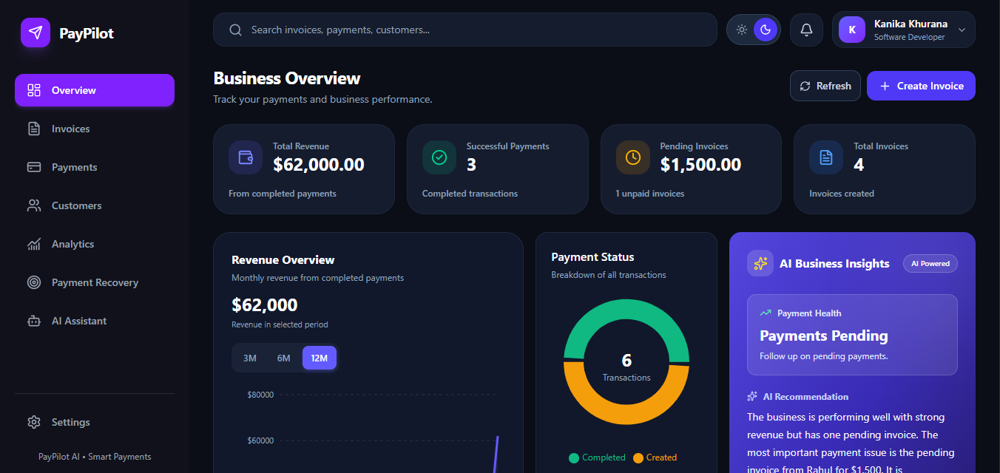
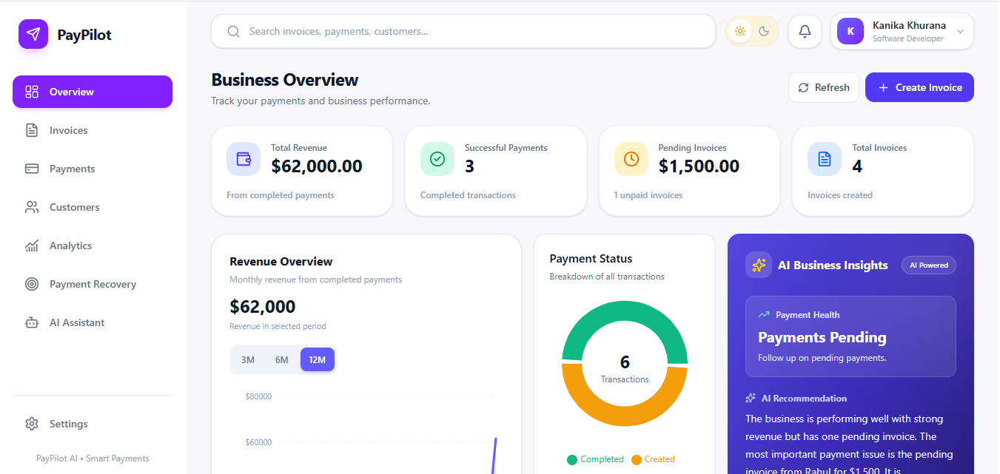
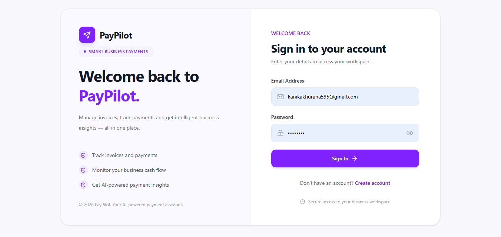
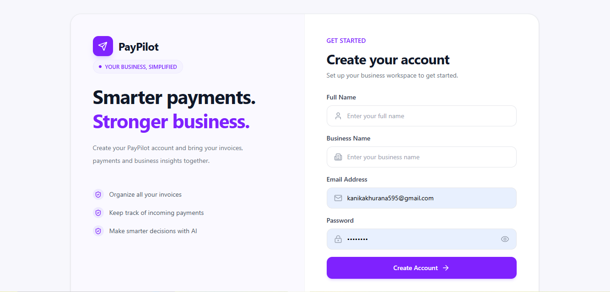
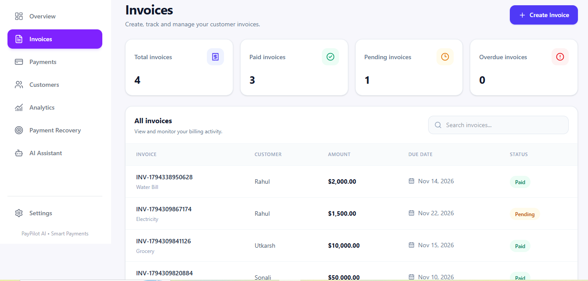
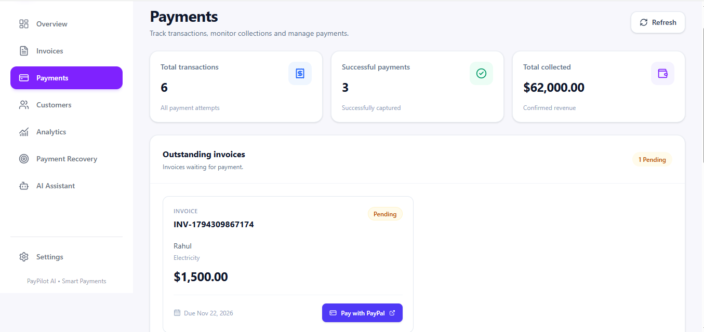
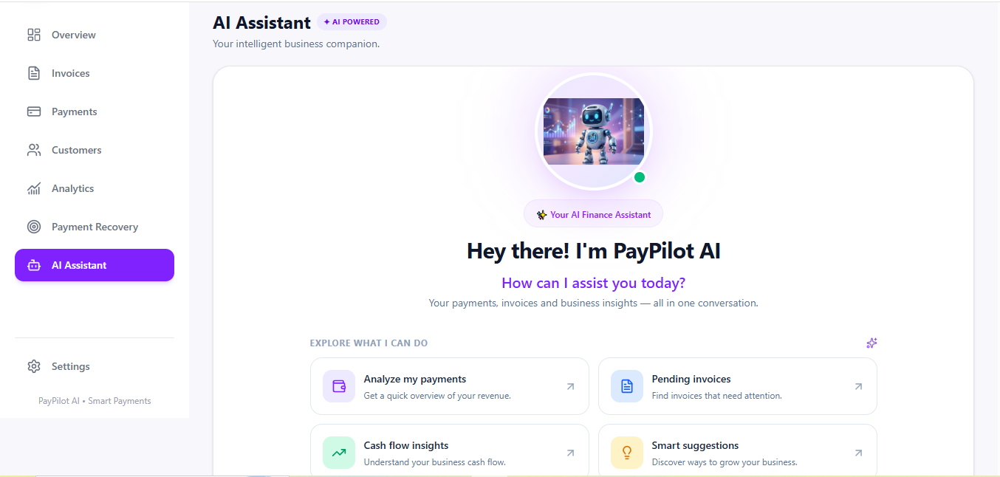
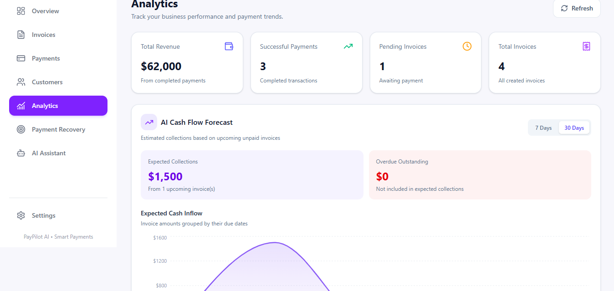
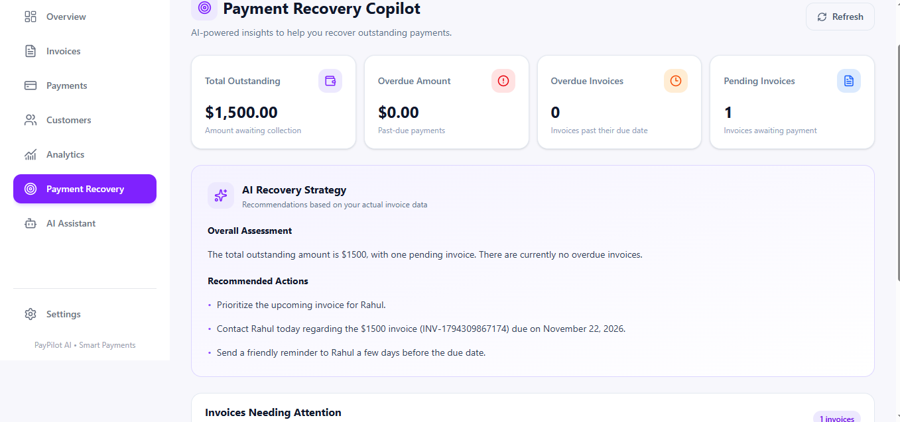

# PayPilot 

<div align="center">

### AI-Powered Payment Recovery Assistant

**Smarter payments. Stronger business.**

[](https://pay-pilot-ai-payment-assistant.vercel.app/)
[](https://github.com/Kanikakhurana18/PayPilot-AI-Payment-Assistant)
[](LICENSE)

</div>

---

## About PayPilot

PayPilot is an AI-powered payment management and recovery platform designed for freelancers and small businesses. It helps business owners manage invoices, collect payments through PayPal, monitor cash flow, and make smarter payment decisions with AI-powered insights.

**Live Demo:** [Explore PayPilot](https://pay-pilot-ai-payment-assistant.vercel.app/)

**GitHub Repository:** [View Source Code](https://github.com/Kanikakhurana18/PayPilot-AI-Payment-Assistant)


## Application Preview

PayPilot provides a modern and responsive interface with **both Light Mode and Dark Mode**, allowing users to choose their preferred visual experience.

### Dark Mode



### Light Mode



---

## Authentication

### Login


### Sign Up


## Problem

Small businesses and freelancers often struggle with delayed payments, unpaid invoices, manual payment follow-ups, and limited visibility into their cash flow.

PayPilot aims to simplify this process by combining payment management, PayPal integration, and AI-powered assistance in one platform.

## Key Features

- **Dashboard:** View revenue, successful payments, pending invoices, and overall business activity.
- **Invoice Management:** Create, update, track, and manage customer invoices.
- **PayPal Integration:** Create PayPal payment orders and process payments using PayPal Sandbox.
- **Customer Management:** Maintain customer information and manage customer records.
- **AI Business Insights:** Get AI-generated insights based on business payment data.
- **AI Payment Reminders:** Generate payment reminders to help follow up on pending invoices.
- **Payment Recovery Copilot:** Monitor outstanding payments and get AI-assisted recovery suggestions.
- **Cash Flow Analytics:** Visualize payment trends and business cash flow.
- **AI Assistant:** Ask questions about payments, invoices, and business performance.
- **Authentication:** Secure user registration and login with user-specific data.
- **Light & Dark Mode:** Switch between light and dark themes.
- **Responsive UI:** Access PayPilot across desktop and mobile devices.

## Screenshots

### Invoice Management



### Payments



### AI Assistant



### Analytics



### Payment Recovery Copilot



## Tech Stack

**Frontend**
- React
- Vite
- Tailwind CSS
- React Router
- Axios
- Recharts
- Lucide React

**Backend**
- Node.js
- Express.js
- MongoDB Atlas
- Mongoose
- JSON Web Tokens (JWT)
- bcryptjs

**AI Integration**
- OpenRouter API
- OpenAI GPT-4o-mini

**Payment Integration**
- PayPal REST API
- PayPal Sandbox

**Deployment**
- Frontend: Vercel
- Backend: Render
- Database: MongoDB Atlas

## Architecture

```text
React + Vite Frontend
        |
        | REST API
        v
Node.js + Express Backend
        |
        +------ MongoDB Atlas
        |
        +------ OpenRouter AI
        |
        +------ PayPal REST API
```

## Getting Started

### Prerequisites

- Node.js and npm
- MongoDB Atlas account
- OpenRouter API key
- PayPal Developer account with Sandbox credentials

### 1. Clone the Repository

```bash
git clone https://github.com/Kanikakhurana18/PayPilot-AI-Payment-Assistant.git
cd PayPilot-AI-Payment-Assistant
```

### 2. Set Up the Backend

```bash
cd server
npm install
```

Create a `.env` file inside the `server` directory:

```env
PORT=8000
MONGO_URI=your_mongodb_connection_string
JWT_SECRET=your_jwt_secret
PAYPAL_CLIENT_ID=your_paypal_sandbox_client_id
PAYPAL_CLIENT_SECRET=your_paypal_sandbox_client_secret
PAYPAL_API_BASE=https://api-m.sandbox.paypal.com
OPENROUTER_API_KEY=your_openrouter_api_key
FRONTEND_URL=http://localhost:5173
```

Start the backend:

```bash
npm run dev
```

### 3. Set Up the Frontend

Open another terminal:

```bash
cd client
npm install
```

Create a `.env` file inside the `client` directory:

```env
VITE_API_URL=http://localhost:8000/api
```

Start the frontend:

```bash
npm run dev
```

Open the local URL displayed by Vite, usually:

```text
http://localhost:5173
```

## Payment Testing

PayPilot uses PayPal Sandbox for testing payment workflows.

Use PayPal Sandbox test accounts created through the PayPal Developer Dashboard. Sandbox transactions do not represent real payments.

## Security Notes

- Never commit `.env` files or expose API keys and secrets.
- Use Sandbox credentials for payment testing.
- Keep PayPal and AI API credentials on the backend.
- Authentication and user-specific data access are handled by the backend.

## Future Scope

- Automated payment follow-up scheduling.
- More advanced payment risk analysis.
- Additional payment gateway integrations.
- Improved AI-driven cash flow recommendations.

## License

This project is licensed under the MIT License. See the [LICENSE](LICENSE) file for details.

---

<div align="center">

**Built for the PayPal AI Hackathon 2026.**

</div>